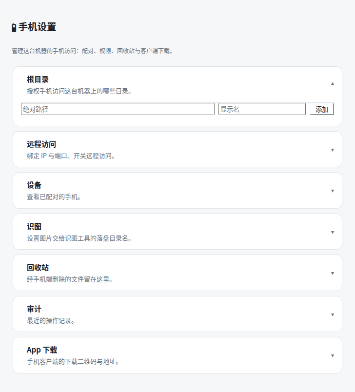

# dsh-remote-bridge

<p align="center">
  <strong>Translates DSH's private remote protocol into a versioned REST API for mobile and third-party clients, plus a centralized settings center on the desktop.</strong>
</p>

<p align="center">
  <a href="./README.md">中文</a> · English
</p>

<p align="center">
  
  
  
  
</p>

`dsh-remote-bridge` is the remote-access bridge plugin for DeepSeek Harness (DSH). It translates DSH's private remote protocol into a versioned REST API so dsh-companion ([GitHub](https://github.com/westanke/dsh-companion) · [Gitee](https://gitee.com/westanke/dsh-companion)) and other trusted clients can keep using the same chat, workspace, and file capabilities while away from the machine. On the desktop it provides a **Phone settings** section inside your DSH settings, rendering seven collapsible cards inline (Roots / Remote / Devices / Image reading / Trash / Audit / App download), each folding on its own and several may stay open at once. **The desktop no longer offers a file-management UI**: the file tree and editor were deleted in 2.2.0 — manage files from the phone app, or ask the agent to use its tools in a conversation (see "No file-management UI on the desktop").

The interface is bilingual and defaults to Chinese. Prebuilt packages run on Windows, macOS, and Linux without compiling on the target server.

> **Version warning**: the published `v2.0.0` and `v2.0.1` have serious defects (`v2.0.0` fails to read any historical images; `v2.0.1` cannot activate the plugin). Use **`v2.2.0`** (or ≥ `v2.0.4`).
> `v2.0.2` and `v2.0.3` were **never released** — do not look for installers under those version numbers.

> **DSH 0.2.x compatibility**: this branch adds a compatibility layer for DSH `0.2.0-rc.2` on top of
> upstream `v1.0.0`. DSH 0.2.x replaced `dsh-host-apiproxy` (which provided the `apiProxy` service)
> with `dsh-api-gateway`, leaving the upstream release unable to start on 0.2.x — it surfaces as
> "adding an authorized root returns 405". Background, rationale, changes, and test results are in
> [DSH 0.2.x compatibility notes](./docs/project/DSH-0.2-COMPAT.md).
>
> **Adaptation to DSH 0.2.1-rc.2** (rechecked 2026-10-20; see `docs/project/DSH-0.2.1-ADAPTATION.md`):
> this plugin **deliberately imports no `@deepseek-ai/*` package** — every host service is consumed
> through a structural type injected by the running Host (see the header comment in
> `src/host/dsh-0.2-bridge.ts`). Checked one by one against the installed `0.2.1-rc.2` packages:
> all 10 `inject` service names in `cordis.patch.yml` **still exist with unchanged signatures**, and
> `engines.dsh` is recognized by the 0.2.1 kernel (`prepareProfileEntries` in
> `dsh-app-boot/lib/index.js`) — an unmet range only sets that entry to `disabled` and prints to
> stderr; **the host process does not exit**. So no code change is needed to run on `0.2.1-rc.2`.
>
> **Functional differences between the two versions (important)**: the `inject` list holds **only
> services that exist in both versions** — cordis treats `inject` as a **hard dependency**, and a
> single missing service leaves the whole plugin inactive (proven by CI on the 0.2.0-rc.2 baseline:
> writing a 0.2.1-only service into `inject` once made the plugin fail to activate on 0.2.0).
> The services that only 0.2.1 provides (**background jobs** `jobController`, the **permission
> catalog** `permissionPresets`, file upload `fileUploads`, attachment storage `attachments`) are
> therefore read at runtime through `ctx.reflect.get(name, false)`: **all of them work on
> 0.2.1-rc.2 and degrade automatically on 0.2.0-rc.2** (the jobs endpoints answer 404 there, the
> permission catalog falls back to its built-in one) — the plugin itself runs on both kernels.
> `GET /api/v1/debug/host-services` reports which optional capabilities the current machine has.

## What it looks like

The desktop entry lives **inside your DSH settings**: look for the section titled **📱 Phone settings**, which renders seven collapsible cards inline — no second dialog. It is settings-only and contains **no file tree**: the standalone page `/dsh-workspace` and its file tree and CodeMirror editor were deleted in 2.2.0. The reason and the cost are covered in "No file-management UI on the desktop" below.

Remote access remains disabled until a local administrator chooses a bind address, port, and initial device permissions.



> **About these screenshots.** The four images under `assets/screenshots/` are generated by `scripts/generate-screenshots.ts`, which renders the panel from the same sources the tests use — `ADMIN_TABS`, `WORKSPACE_CSS` and `APP_QR_CODES` out of `src/client/` — so what you see is the shipped markup and stylesheet, not a redrawn mock-up. They show a machine that has just installed the plugin and not yet enabled remote access, which is the honest default state. An earlier revision of this README carried two UI screenshots; both predated the rename and showed the file tree and settings as two stacked dialogs, so they were removed rather than left to mislead.
>
> Storefronts pick these up automatically from [`screenshots.json`](./screenshots.json) — no pull request, no waiting on a maintainer. Update the images and push; the next build takes them.

## About the rename (2.0.4)

The plugin was renamed from `dsh-workspace` to `dsh-remote-bridge`. The old name was narrower than the content: the plugin actually translates DSH's private remote protocol into versioned REST so a phone can reach this machine remotely, and adds a settings center on top — "workspace" is only one page of that.

**The rename only changes what you install and what the bundle is called. The following external contracts are deliberately unchanged:**

| Unchanged | Location | Why it must stay |
| --- | --- | --- |
| REST prefix `/dsh-workspace-api` | `src/host/server.ts` | Published apps hard-code it |
| State directory (`dataDir`, default `dsh-workspace`) | DSH profile config | A new directory would erase every authorized root and the trash |

**Two items that are no longer contracts** (both retired with the standalone page in 2.2.0):

- **The standalone page path `/dsh-workspace`**: that page (file tree + CodeMirror editor) was deleted, so the path went with it. It is a different thing from the REST prefix `/dsh-workspace-api` — **the prefix stays and remains the app's contract; the page is gone and promises nothing**.
- **The browser storage key `dsh-workspace-device-token`**: only that deleted page ever read or wrote it; nothing in this repo or in the app touches it now. A key nobody reads is not a contract, so it is not listed above. The name itself is not recycled, to avoid adding a red herring when debugging later.

So seeing `dsh-workspace` in a REST address or the state directory is **expected**, not an incomplete rename.

## Quick install

### Requirements

- A working DeepSeek Harness WebUI installation
- DSH kernel **`>=0.2.0-rc.2 <0.3.0`** (compatible with `0.2.0-rc.2` and every later `0.2.x`, including
  `0.2.1-rc.2`; supported by this branch's compatibility layer — see
  [DSH 0.2.x compatibility notes](./docs/project/DSH-0.2-COMPAT.md)).
  `package.json` declares the same range under `engines.dsh`; the kernel resolves it with semver and
  only **disables** the plugin when unmet (the host process keeps running), with the user able to
  grant an exact-version exemption as the kernel suggests.
- Node.js `^22.19.0` or `>=24.0.0`
- Port `3090`, or another available port

Run as the same operating-system user that runs DSH WebUI. **The npm package name is recommended** — all three routes install the same build:

```sh
# 1. npm package name (recommended: a prebuilt tarball, so pnpm never asks to approve a build)
dsh plugin --profile web add dsh-remote-bridge

# ...or point at the mainland-China mirror
dsh plugin --profile web add dsh-remote-bridge --registry https://registry.npmmirror.com

# 2. tarball from the GitHub release
dsh plugin --profile web add https://github.com/westanke/dsh-remote-bridge/releases/download/v2.5.2/dsh-remote-bridge-v2.5.2.tgz

# 3. tarball from the Gitee release (faster from mainland China)
dsh plugin --profile web add https://gitee.com/westanke/dsh-remote-bridge/releases/download/v2.5.2/dsh-remote-bridge-v2.5.2.tgz

npx @deepseek-ai/dsh web
```

> `dsh plugin add` is a thin wrapper over `pnpm add`, so pnpm options such as `--registry` work directly.
>
> This README is shared verbatim by GitHub and Gitee, so any address that must carry a hostname
> (the install commands, release downloads) lists both hosts. Relative links follow the site you
> are reading on, but `/releases/download/...` has no relative form. The npm package name is the
> same as the GitHub repository, so it reads identically on both hosts.

Restart DSH after installation, then open settings — The section is titled **📱 Phone settings**. It is settings-only and does **not** contain the file tree. The in-conversation **Files** tab was removed in 2.0.4. **The desktop no longer offers a UI for browsing or editing files**: the standalone page `/dsh-workspace` was deleted in 2.2.0 — use the phone app, or ask the agent to use its tools in a conversation.

To install a downloaded release archive:

```sh
dsh plugin --profile web add ./dsh-remote-bridge-v2.5.2.tgz
```

## First connection

1. Open DSH settings and go to **Phone settings** (it lands on **Roots**).
2. Add a local directory under **Roots** and give it a recognizable label.
3. For mobile access, go to **Remote**, enter the bind IP and port, and save them.
4. Select **Enable and create pairing**, then enter the ten-minute one-time code in the app.
5. In the phone app's file page, select that root to browse and edit files.

Remote access cannot be enabled before at least one root exists. Installing the plugin does not expose it to the LAN; it listens on loopback until a local administrator enables remote access.

## Features

### No file-management UI on the desktop

2.2.0 deleted the standalone page `/dsh-workspace`, including the whole file tree, the upload/download entry points, and the CodeMirror 6 editor. The phone app's file page already covers the same ground natively, nobody used the desktop page, and it bloated the published package from **0.25 MB to 1.72 MB**.

The cost, stated plainly — **on the desktop there are now only two ways to touch files**:

1. Talk to the agent in a conversation and let it read and write files with its tools;
2. Open a terminal and do it yourself.

Mobile is unaffected: the app's file page still works against the same REST file endpoints the plugin kept (`/dsh-workspace-api` prefix, `/roots`, `/roots/{rootId}/content`, and so on — none were removed). Trash entries now come only from the phone app.

### Desktop settings panel

The entry lives in DSH settings under the title **Phone settings**. It renders seven cards stacked inline — no pop-up, no navigation rail — landing on **Roots** expanded:

| Section | Purpose |
| --- | --- |
| Roots | Add or remove authorized directories and set display labels. The current DSH workspace is registered automatically as a **default root** — it cannot be removed, but it stays fully accessible |
| Remote | Set bind IP/port, enable remote access, and create pairing codes |
| Devices | Inspect and revoke device scopes and per-root grants |
| Image reading | Set the handoff directory (the image-reading path); shows the read-only factory default `.dsh-images` and the fallback directory |
| Trash | View and restore deleted entries (only deletions made from the phone app appear here) |
| Audit | Operation type and target audit records |
| App download | Scan to install the Android client; the codes point at both hosts' Releases list pages |

The sidebar gear button was **removed**: having the entry in both the sidebar and the settings page gave one thing two starting points. The in-conversation **Files** tab is gone too, so the desktop now has exactly one entry point.

### Image handoff: a picture sent from the phone, visible on the desktop

When the active model cannot see images (a text-only model), this plugin saves the picture as a workspace file **before the message is sent**, and the message keeps exactly two things: one plain-language line (where the file went, and what to do to view it) plus one absolute path for an image-reading tool.

**The DSH WebUI now renders that picture at the end of the turn** — click for the full image, `Escape` or click anywhere to close — while the path stays underneath it. The phone app could already show it; the desktop previously showed only text. Both now agree.

- **Where it lands**: `<session working directory>/<image path>/<sha256>.<ext>`. The file name is a content hash, so sending the same picture twice never piles up copies (directory `0700`, file `0600`).
- **Image path** defaults to `.dsh-images` and is editable under the **Image reading** section of the settings panel; changes take effect immediately, with no restart. The **Current default** field is **read-only** — past handoff messages and image-reading tools wrote their paths against it, so it does not follow your edit. The section also shows the fallback directory used when a session working directory cannot be resolved.
- **Only the handoff sentence is parsed**, and only in **your own message**: `.dsh-images/…` references inside assistant prose, context injections, or tool output are never turned into pictures (they are everywhere, and rendering them just shreds other people's words).

> If you previously installed `dsh-image-paths`, **disable** that row: both plugins attach their gallery to the same seat, so one picture would be drawn twice. This plugin already carries the capability.

### Stable client API

The companion Android client is [dsh-companion](https://github.com/westanke/dsh-companion)
([Gitee](https://gitee.com/westanke/dsh-companion)) — scan either code below with your phone to
download it. Both point at the **Releases list page** of their host, so publishing a new version
never requires regenerating them:

| GitHub | Gitee (faster from mainland China) |
| --- | --- |
|  |  |
| <https://github.com/westanke/dsh-companion/releases> | <https://gitee.com/westanke/dsh-companion/releases> |

> The codes encode the Releases **list page**, not a specific APK filename — so a new release
> never needs new artwork, and whoever scans always lands on the latest version. Both images are
> produced by `pnpm qr:app` (`scripts/generate-app-qr.mjs`), which verifies its own output with an
> independent decoder; the test suite also decodes the committed files back and checks the address.

Once the app is installed, generate a config text or pairing code under
**Phone settings → Remote access** to connect it to this machine.

The public API is independent of DSH private wire protocols. Authorized clients can:

- list, register, rename, and remove DSH workspace registrations;
- create, rename, fork, and archive sessions;
- read history, stream text and reasoning, steer messages, and cancel runs;
- display TODOs, slash commands, permission modes, and approval requests;
- select Agents, models, and reasoning effort;
- inspect or update built-in and fully custom model providers;
- manage files and trash within explicitly granted roots.

## Remote access and security

The default remote target is `0.0.0.0:3090`; both values are configurable. Clients may connect through any reachable IP address or domain name.

HTTP is supported and TLS is not mandatory. That keeps trusted-LAN and temporary deployments simple, but plain HTTP sends device tokens, chat, and file content in clear text. Use HTTPS through Caddy/Nginx, a VPN, Tailscale/WireGuard, or a trusted tunnel on public or untrusted networks.

The following controls remain active over both HTTP and HTTPS:

- ten-minute, single-use pairing codes;
- 256-bit device tokens stored server-side only as digests;
- revocable scopes and per-root grants;
- separate rate limits for pairing, authentication failures, and normal requests;
- audit records that omit tokens, file bodies, and chat bodies;
- no automatic access to roots added after a device was paired.

Only a loopback client may add roots, change device grants, create pairing codes, configure the listener, or permanently purge trash.

## Path boundary

External requests use `rootId + relativePath`, never an absolute server path.

- Wire paths use `/`.
- Absolute paths, drive letters, UNC paths, backslashes, null bytes, and `.` or `..` segments are rejected.
- Every operation checks path segments for symlinks, junctions, and reparse points.
- Deleting a final link removes the link itself without traversing its target.
- Save temp files are placed beside the destination to avoid cross-device replacement failures.

Removing a DSH workspace removes only its WebUI registration. Directories, files, and session logs remain. Archiving a session hides it from the default list while preserving its log.

## Public API

REST base URL:

```text
http://HOST:PORT/api/v1
```

Every request except health and pairing exchange uses:

```http
Authorization: Bearer DEVICE_TOKEN
```

| Endpoint | Purpose |
| --- | --- |
| `GET /healthz` | Service, API, and plugin version |
| `POST /pairings/exchange` | Exchange a one-time code for a device token |
| `GET /devices/self` | Current device, scopes, and root grants |
| `GET /roots` | Granted file roots |
| `GET/POST/PATCH/DELETE /roots/{rootId}/entries` | List, create, move, rename, and trash entries |
| `GET/PUT /roots/{rootId}/content` | Read, Range download, upload, and ETag-safe save |
| `GET /trash`, `POST /trash/{id}/restore` | List and restore trash items |
| `GET/POST /chat/workspaces` | List or register DSH workspaces |
| `PATCH/DELETE /chat/workspaces/{id}` | Rename or remove workspace registrations |
| `GET/POST /chat/sessions` | List or create sessions |
| `PATCH /chat/sessions/{id}` | Rename a session |
| `POST /chat/sessions/{id}/fork` | Fork a session |
| `POST /chat/sessions/{id}/archive` | Archive a session |
| `GET/POST /chat/sessions/{id}/messages` | Read history, send, or steer messages |
| `GET/POST /chat/sessions/{id}/commands` | List or run host slash commands |
| `GET/POST /chat/sessions/{id}/approvals...` | View and decide approval requests |
| `GET /chat/sessions/{id}/models`, `PUT .../model` | Model catalog, selection, and reasoning effort |
| `PUT /chat/sessions/{id}/agent-preset` | Select an Agent before the first message |
| `POST /chat/runs/{id}/cancel` | Cancel a running session |
| `GET/POST/PATCH/DELETE /settings/...` | Providers, credential status, model discovery, and custom providers |
| `WS /events` | Chat deltas, runs, approvals, and file events |

See the [OpenAPI 3.1 contract](./docs/api/openapi.yaml), [AsyncAPI contract](./docs/api/asyncapi.yaml), and included [Kotlin SDK](./kotlin-sdk/README.md) for exact schemas.

Errors use one envelope:

```json
{"error":{"code":"ERROR_CODE","message":"Readable message","requestId":"..."}}
```

## Device scopes

| Scope | Access |
| --- | --- |
| `chat.read` | Workspaces, sessions, messages, TODOs, commands, and approvals |
| `chat.write` | Manage workspaces/sessions, send, configure, run commands, and decide approvals |
| `files.read` | Browse, read, download, and view trash |
| `files.write` | Create, edit, upload, move, and rename |
| `files.delete` | Move files or directories to plugin trash |
| `settings.read` | Effective provider configuration and credential presence |
| `settings.write` | Provider changes, credential writes, and custom providers |

A device also needs an explicit grant for every `rootId`. Local administrators may change or revoke both scopes and root grants at any time.

**New scopes are picked before pairing, in Remote access**: whatever you tick is what the generated pairing code carries, and those scopes take effect once the app enters the code. For a device that is already paired, open **Devices** and use its **Permissions** button.

**Revoking a device deletes it from the database** rather than leaving a marker row behind. Its grants go with it, while the audit trail (who revoked which device, and when) is kept.

## Upgrade and uninstall

Stop DSH WebUI before upgrading, install the new package, then restart it. To uninstall:

```sh
dsh plugin --profile web remove dsh-remote-bridge
```

State is stored under `dsh-workspace` in the active `DSH_HOME`. Uninstalling does not erase state or trash, preventing accidental loss of recoverable files.

The 2.0.4 rename does not change that directory name: after upgrading, existing root grants and trash stay where they are. No migration is needed.

## Compatibility and known limits

### Some DSH builds have no attachment store

DSH's cordis injection properties (`ctx.attachments` / `ctx.fileUploads`) resolve lazily, and reading a service that nothing provides throws. Since 2.0.3 the plugin reads them tolerantly: when a service is absent the plugin still activates, and only the endpoint that actually needs it returns a readable error:

- `ATTACHMENT_STORE_UNAVAILABLE`: no `ctx.attachments`, so stored image bytes cannot be read.
- `FILE_UPLOADS_UNAVAILABLE`: no `ctx.fileUploads`, so attachments cannot be sent.

The user-visible consequence: **if this DSH build provides no attachment store, historical images in conversations cannot be displayed, but everything else in the plugin works normally** — and clients show the specific reason instead of a vague "image unavailable".

## Troubleshooting

**Phone settings is missing**

The entry is inside DSH settings, under the title **📱 Phone settings**. If you cannot see it, make sure the plugin was installed into the `web` profile and **restart DSH** — plugins load in-process and a restart is required.

**There is no UI for browsing or editing files on the desktop**

That is intentional in 2.2.0: the standalone page `/dsh-workspace` was deleted and the desktop no longer offers a file-management UI. Use the phone app's file page, or ask the agent to read and write files with its tools in a conversation.

**Enable and create pairing is disabled**

Add at least one root. If the bind IP or port changed, save the listener settings first.

**The phone cannot connect**

Confirm remote access is enabled, the firewall/security group allows the port, and the address is reachable from the phone. Do not use the server's own `127.0.0.1` address.

**A save reports a conflict**

Another window or process changed the file. Reload it, merge the desired changes, and save again.

## Build from source

```sh
pnpm install --frozen-lockfile
pnpm check
pnpm pack
```

`pnpm check` covers type-checking, documentation consistency, and tests. It currently passes **67 test files / 557 cases**, plus **8 browser-layer cases** (Playwright measuring real computed styles, including the 375px narrow-viewport contract).

`npm pack` produces roughly a **0.61 MB** archive (v2.5.2 measured 635,325 bytes, SHA-256 `18d36904…c8095`): 2.2.0 dropped the standalone page and its editor dependencies and turned source maps off, down from 1.72 MB; it has since grown slightly with projection passthrough, the permission BFF, and the five-dimension hardening.

v2.5.0 was verified on DSH **0.2.1-rc.2** on real hardware: all 14/14 host services injected, the three jobs endpoints exercised, and the permission catalog returned the kernel's real three presets. The development baseline is upstream `dsh-v0.2.1-rc.2` (commit `687f282e8625c6b8d11ff58211a90524be2e4317`); see `engines.dsh` above for the supported range. CI covers Windows, Ubuntu, and macOS.

**v2.5.2 verification status**: 67 test files / 557 cases green, plus 8 Playwright browser cases
(including the 375px narrow-viewport contract); `typecheck`, `docs:check`, and the build all pass.
All three rounds of real-hardware tunnel regressions were reproduced and verified on a
React18 + Playwright click harness (one-click token issuance, the stop-tunnel escape hatch, and the
locked state when re-entering settings), then confirmed by manual testing on the user's machine.

## Project

- Version: `v2.5.2`
- **v2.5.2 is a comprehensive hardening release**: it lands the five-dimension audit
  (security, features, performance, UI, button feedback) — including the unauthenticated
  `debug/host-services` information disclosure fix, dual-bucket rate limiting, broadcast backpressure,
  weak ETags, and audit retention — and makes "start tunnel & generate token" complete inside a single
  request. While the tunnel runs, the management surface is safely locked with only "stop tunnel"
  available, restoring automatically afterwards. v2.5.1's security model (403 on `/manage` while a tunnel
  runs, the four-layer admin criteria) is unchanged; see `docs/project/SECURITY.md` §「管理面的信任边界」.
- **v2.5.1 was the security release**: it closed the remote privilege escalation and the `.heif`
  handoff-image 415 bug described in the changelog.
- Author: upstream [Hakunm](https://github.com/Hakunm); this fork maintained by [westanke](https://github.com/westanke)
- Repository: [GitHub](https://github.com/westanke/dsh-remote-bridge) · [Gitee](https://gitee.com/westanke/dsh-remote-bridge)
- npm: [`dsh-remote-bridge`](https://www.npmjs.com/package/dsh-remote-bridge) ([mainland-China mirror](https://registry.npmmirror.com/dsh-remote-bridge))
- License: [GNU Affero General Public License v3.0](./LICENSE)
- Android client: dsh-companion ([GitHub](https://github.com/westanke/dsh-companion) · [Gitee](https://gitee.com/westanke/dsh-companion)), a fork of the upstream [dsh-android-app](https://github.com/Hakunm/dsh-android-app), kept in step with this plugin
