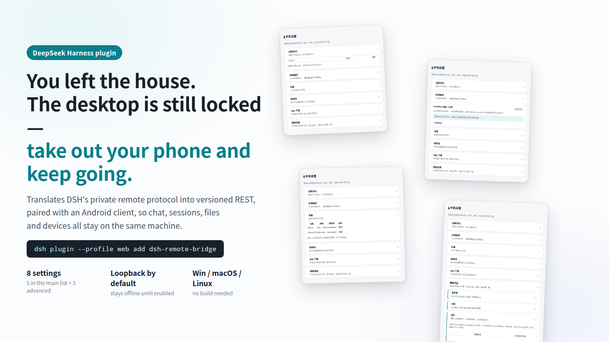
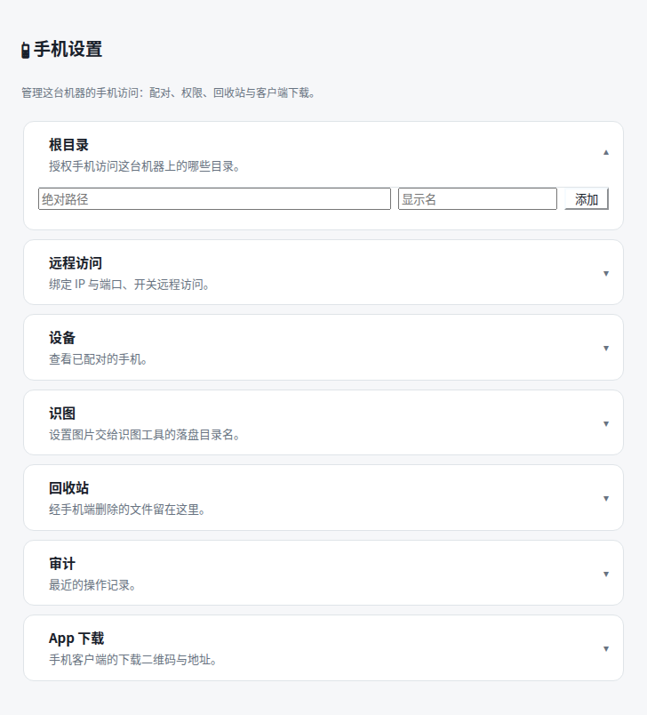

# dsh-remote-bridge

<p align="center">
  <strong>You left the house. The desktop is still locked. Take out your phone and keep using that machine.</strong><br>
  Translates DSH's private remote protocol into WebSocket frames (primary) plus a versioned REST API (legacy, being retired) so the phone client
  dsh-Chat keeps your chats,
  sessions, files and devices on the same machine.
</p>

<p align="center">
  
</p>

<p align="center">
  <code>dsh plugin --profile web add dsh-remote-bridge</code>
</p>

<p align="center">
  <a href="./README.md">中文</a> ·
  
  
  
  
</p>

`dsh-remote-bridge` is the remote-access bridge plugin for DeepSeek Harness (DSH). It translates DSH's private remote protocol into **two device protocol surfaces**: the bidirectional `/ws/mobile` frames (every new capability lands only here, since v2.8) and the versioned REST `/api/v1` (legacy: frozen, shrink-only, being retired) so dsh-Chat ([GitHub](https://github.com/westanke/dsh-Chat) · [Gitee](https://gitee.com/westanke/dsh-Chat)), among other trusted clients, can keep using the same chat, workspace, and file capabilities while away from the machine. On the desktop it provides a **Phone settings** section inside your DSH settings, rendering collapsible cards inline: five in the main list (Remote / Public tunnel / Devices / Trash / App download) plus a collapsed-by-default **Advanced settings** group holding Roots, Image reading and Plugins — every card folds on its own and several may stay open at once.

**Who it is for**: people who use DSH as their main tool but do not want to be tied to the desk. Remote access is **off by default** — until you enable it, the plugin listens on loopback only, so installing it never exposes the machine to the LAN by itself.

The interface is bilingual and defaults to Chinese. Prebuilt packages run on Windows, macOS, and Linux without compiling on the target server.

> **Version warning**: the published `v2.0.0` and `v2.0.1` have serious defects (`v2.0.0` fails to read any historical images; `v2.0.1` cannot activate the plugin). Use **`v2.2.0`** (or ≥ `v2.0.4`).
> `v2.0.2` and `v2.0.3` were **never released** — do not look for installers under those version numbers.
>
> **DSH 0.2.x compatibility** and the **0.2.1-rc.2 adaptation notes** involve the trade-offs of the
> injected services and run long, so they live in
> [Compatibility & known limits](#compatibility--known-limits) — worth a skim before installing.

## What it looks like

The desktop entry lives **inside your DSH settings**: look for the section titled **📱 Phone settings**, which renders collapsible cards inline (five in the main list plus an Advanced settings group) — no second dialog. It is settings-only and contains **no file tree**: the standalone page `/dsh-workspace` and its file tree and CodeMirror editor were deleted in 2.2.0. The reason and the cost are covered in "No file-management UI on the desktop" below.

Remote access remains disabled until a local administrator chooses a bind address, port, and initial device permissions.



> **About these screenshots.** The four images under `assets/screenshots/` are generated by `scripts/generate-screenshots.ts`, which renders the panel from the same sources the tests use — `ADMIN_TABS`, `WORKSPACE_CSS` and `APP_QR_CODES` out of `src/client/` — so what you see is the shipped markup and stylesheet, not a redrawn mock-up. They show a machine that has just installed the plugin and not yet enabled remote access, which is the honest default state. An earlier revision of this README carried two UI screenshots; both predated the rename and showed the file tree and settings as two stacked dialogs, so they were removed rather than left to mislead.
>
> Storefronts pick these up automatically from [`screenshots.json`](./screenshots.json) — no pull request, no waiting on a maintainer. Update the images and push; the next build takes them.

## About the rename (2.0.4)

The plugin was renamed from `dsh-workspace` to `dsh-remote-bridge`. The old name was narrower than the content: the plugin actually translates DSH's private remote protocol into versioned REST so a phone can reach this machine remotely, and adds a settings center on top — "workspace" is only one page of that.

**The rename only changes what you install and what the bundle is called. The following external contracts are deliberately unchanged:**

| Unchanged | Location | Why it must stay |
| --- | --- | --- |
| REST prefix `/dsh-workspace-api` | `src/host/server.ts` | Published apps hard-code it |
| State directory (`dataDir`, default `dsh-workspace`) | DSH profile config | A new directory would erase every authorized root and the trash |

**Two items that are no longer contracts** (both retired with the standalone page in 2.2.0):

- **The standalone page path `/dsh-workspace`**: that page (file tree + CodeMirror editor) was deleted, so the path went with it. It is a different thing from the REST prefix `/dsh-workspace-api` — **the prefix stays and remains the app's contract; the page is gone and promises nothing**.
- **The browser storage key `dsh-workspace-device-token`**: only that deleted page ever read or wrote it; nothing in this repo or in the app touches it now. A key nobody reads is not a contract, so it is not listed above. The name itself is not recycled, to avoid adding a red herring when debugging later.

So seeing `dsh-workspace` in a REST address or the state directory is **expected**, not an incomplete rename.

## Quick install

### Requirements

- A working DeepSeek Harness WebUI installation
- DSH kernel **`>=0.2.2-rc.1 <0.3.0`** (compatible with `0.2.2-rc.1` and every later `0.2.x`;
  schedule create/edit only exists on the kernel remote surface since `0.2.2`, and attachment
  reads rely on the 0.2.2 semantics — see
  [DSH 0.2.x compatibility notes](./docs/project/DSH-0.2-COMPAT.md) and the
  [DSH 0.2.2 adaptation survey](./docs/project/DSH-0.2.2-ADAPTATION.md)).
  `package.json` declares the same range under `engines.dsh`; the kernel resolves it with semver and
  only **disables** the plugin when unmet (the host process keeps running), with the user able to
  grant an exact-version exemption as the kernel suggests.
- Node.js `^22.19.0` or `>=24.0.0`
- Port `3090`, or another available port

Run as the same operating-system user that runs DSH WebUI. **The npm package name is recommended** — all three routes install the same build:

```sh
# 1. npm package name (recommended: a prebuilt tarball, so pnpm never asks to approve a build)
dsh plugin --profile web add dsh-remote-bridge

# ...or point at the mainland-China mirror
dsh plugin --profile web add dsh-remote-bridge --registry https://registry.npmmirror.com

# 2. tarball from the GitHub release
dsh plugin --profile web add https://github.com/westanke/dsh-remote-bridge/releases/download/v2.14.0/dsh-remote-bridge-v2.14.0.tgz

# 3. tarball from the Gitee release (faster from mainland China)
dsh plugin --profile web add https://gitee.com/westanke/dsh-remote-bridge/releases/download/v2.14.0/dsh-remote-bridge-v2.14.0.tgz

npx @deepseek-ai/dsh web
```

> `dsh plugin add` is a thin wrapper over `pnpm add`, so pnpm options such as `--registry` work directly.
>
> This README is shared verbatim by GitHub and Gitee, so any address that must carry a hostname
> (the install commands, release downloads) lists both hosts. Relative links follow the site you
> are reading on, but `/releases/download/...` has no relative form. The npm package name is the
> same as the GitHub repository, so it reads identically on both hosts.

Restart DSH after installation, then open settings — The section is titled **📱 Phone settings**. It is settings-only and does **not** contain the file tree. The in-conversation **Files** tab was removed in 2.0.4. **The desktop no longer offers a UI for browsing or editing files**: the standalone page `/dsh-workspace` was deleted in 2.2.0 — use the phone app, or ask the agent to use its tools in a conversation.

To install a downloaded release archive:

```sh
dsh plugin --profile web add ./dsh-remote-bridge-v2.14.0.tgz
```

## First connection

1. Open DSH settings and go to **Phone settings** (it lands on **Roots**).
2. Add a local directory under **Roots** and give it a recognizable label.
3. For mobile access, go to **Remote**, enter the bind IP and port, and save them.
4. Select **Enable and create pairing**, then enter the ten-minute one-time code in the app.
5. In the phone app's file page, select that root to browse and edit files.

Remote access cannot be enabled before at least one root exists. Installing the plugin does not expose it to the LAN; it listens on loopback until a local administrator enables remote access.

## Features

### No file-management UI on the desktop

2.2.0 deleted the standalone page `/dsh-workspace`, including the whole file tree, the upload/download entry points, and the CodeMirror 6 editor. The phone app's file page already covers the same ground natively, nobody used the desktop page, and it bloated the published package from **0.25 MB to 1.72 MB**.

The cost, stated plainly — **on the desktop there are now only two ways to touch files**:

1. Talk to the agent in a conversation and let it read and write files with its tools;
2. Open a terminal and do it yourself.

Mobile is unaffected: the app's file page still works against the same REST file endpoints the plugin kept (`/dsh-workspace-api` prefix, `/roots`, `/roots/{rootId}/content`, and so on — none were removed). Trash entries now come only from the phone app.

### Desktop settings panel

The entry lives in DSH settings under the title **Phone settings**. It renders seven cards stacked inline — no pop-up, no navigation rail — landing on **Roots** expanded:

| Section | Purpose |
| --- | --- |
| Roots | Add or remove authorized directories and set display labels. The current DSH workspace is registered automatically as a **default root** — it cannot be removed, but it stays fully accessible |
| Remote | Set bind IP/port, enable remote access, and create pairing codes |
| Devices | Inspect and revoke device scopes and per-root grants |
| Image reading | Set the handoff directory (the image-reading path); shows the read-only factory default `.dsh-images` and the fallback directory |
| Trash | View and restore deleted entries (only deletions made from the phone app appear here) |
| Plugins | See what this profile has installed, enable or disable it, check for updates, and jump to the kernel's plugin list |
| App download | Scan to install dsh-Chat; the codes point at both hosts' Releases list pages |

The sidebar gear button was **removed**: having the entry in both the sidebar and the settings page gave one thing two starting points. The in-conversation **Files** tab is gone too, so the desktop now has exactly one entry point.

### Image handoff: a picture sent from the phone, visible on the desktop

When the active model cannot see images (a text-only model), this plugin saves the picture as a workspace file **before the message is sent**, and the message keeps exactly two things: one plain-language line (where the file went, and what to do to view it) plus one absolute path for an image-reading tool.

**The DSH WebUI now renders that picture at the end of the turn** — click for the full image, `Escape` or click anywhere to close — while the path stays underneath it. The phone app could already show it; the desktop previously showed only text. Both now agree.

- **Where it lands**: `<session working directory>/<image path>/<sha256>.<ext>`. The file name is a content hash, so sending the same picture twice never piles up copies (directory `0700`, file `0600`).
- **Image path** defaults to `.dsh-images` and is editable under the **Image reading** section of the settings panel; changes take effect immediately, with no restart. The **Current default** field is **read-only** — past handoff messages and image-reading tools wrote their paths against it, so it does not follow your edit. The section also shows the fallback directory used when a session working directory cannot be resolved.
- **Only the handoff sentence is parsed**, and only in **your own message**: `.dsh-images/…` references inside assistant prose, context injections, or tool output are never turned into pictures (they are everywhere, and rendering them just shreds other people's words).

> If you previously installed `dsh-image-paths`, **disable** that row: both plugins attach their gallery to the same seat, so one picture would be drawn twice. This plugin already carries the capability.

### Clients and stable client API

Two client repositories are listed side by side; both talk to the same bridge:

- **[dsh-companion](https://github.com/westanke/dsh-companion) ([Gitee](https://gitee.com/westanke/dsh-companion))** — the Android client, a fork of the upstream [dsh-android-app](https://github.com/Hakunm/dsh-android-app). **No longer maintained or updated**; kept for historical reference only.
- **[dsh-Chat](https://github.com/westanke/dsh-Chat) ([Gitee](https://gitee.com/westanke/dsh-Chat))** — Flutter (`app/`, Android 1.0.36 released, with the iOS channel and the HarmonyOS Flutter-OH host) plus the frozen legacy HarmonyOS ArkTS build (`harmony/`). It targets bridge ≥ 2.10.0 (protocol v3, `dsh-mobile-v1` subprotocol).

**There is also an "Access" panel inside dsh-Go (v2.15.0 onwards)**. dsh-Go has a native plugin
protocol: a plugin declares entries in its `package.json` under `dshGo` and registers view functions
in the host process, and the app draws them itself. We use it for a **read-only** dashboard —
remote-access state, listening port, LAN access address, Cloudflare tunnel, root count, and the
authorized device list (name / platform / model / last seen) — plus a one-line strip above the
composer (`Remote on · 2` / `Local only`) that opens the panel when tapped. Its only action is
"copy access info".

**Read-only on purpose**: switching remote access, minting pairing codes and revoking devices are
write operations guarded in the WebUI by device tokens, scope bits and the tunnel runtime. A dsh-Go
connection is an ordinary kernel client and has **no mapping** to this plugin's device table, so a
write button there would let any dsh-Go client bypass the admin surface and change security state.
Opening that door needs a "dsh-Go connection → plugin device/permission" mapping first — a separate
decision (see [SECURITY.md](docs/project/SECURITY.md)).

Scan any code below with your phone to download — each points at the **Releases list page** of its
host, so publishing a new version never requires regenerating them:

| Client | GitHub | Gitee (faster from mainland China) |
| --- | --- | --- |
| dsh-Chat |  |  |

Download pages (same targets as the codes):

- dsh-Chat: <https://github.com/westanke/dsh-Chat/releases> · <https://gitee.com/westanke/dsh-Chat/releases>
- dsh-companion: <https://github.com/westanke/dsh-companion/releases> · <https://gitee.com/westanke/dsh-companion/releases> (**no longer maintained; archive only** — no QR code, open the link directly)

> The codes encode the Releases **list page**, not a specific APK filename — so a new release
> never needs new artwork, and whoever scans always lands on the latest version. Both images are
> produced by `pnpm qr:app` (`scripts/generate-app-qr.mjs`), which verifies its own output with an
> independent decoder; the test suite also decodes the committed files back and checks the address.

Once the app is installed, generate a **connection code** or a pairing code under
**Phone settings → Remote access** to connect it to this machine.

The connection code is one line, `<url1>,<url2>,…#<pairingCode>`: the left half is an
**ordered candidate list** (tunnel first, then the LAN and virtual-network addresses detected on
this machine), the right half is an 8-character, 10-minute, single-use pairing code. A client that
probes picks the local address at home and the tunnel when you are away, so one line works in both
places; older clients that only read the first entry still get the tunnel, which works everywhere.
Add your own public address (DDNS + port forwarding, or IPv6) by passing it in `endpoints`.

Since 2.17.0 the long `DSH1:` text is no longer generated (issue #28): a 400+ character single-line
credential gets **characters dropped** when forwarded through WeChat or email, which turned the
device token into a key that matched no row in the database — the phone only reported "token is
invalid" with no hint that the message itself had been mangled.

The public API is independent of DSH private wire protocols. Authorized clients can:

- list, register, rename, and remove DSH workspace registrations;
- create, rename, fork, and archive sessions;
- read history, stream text and reasoning, steer messages, and cancel runs;
- display TODOs, slash commands, permission modes, and approval requests;
- select Agents, models, and reasoning effort;
- inspect or update built-in and fully custom model providers;
- manage files and trash within explicitly granted roots.

## Remote access and security

The default remote target is `0.0.0.0:3090`; both values are configurable. Clients may connect through any reachable IP address or domain name.

HTTP is supported and TLS is not mandatory. That keeps trusted-LAN and temporary deployments simple, but plain HTTP sends device tokens, chat, and file content in clear text. Use HTTPS through Caddy/Nginx, a VPN, Tailscale/WireGuard, or a trusted tunnel on public or untrusted networks.

The following controls remain active over both HTTP and HTTPS:

- ten-minute, single-use pairing codes;
- 256-bit device tokens stored server-side only as digests;
- revocable scopes and per-root grants;
- separate rate limits for pairing, authentication failures, and normal requests;
- audit records that omit tokens, file bodies, and chat bodies;
- no automatic access to roots added after a device was paired;
- provider `baseURL` changes are limited to public http(s) destinations, and moving a
  provider that already stores a credential to a new host also requires a fresh API key
  (the kernel sends that key to the address, so this is a credential boundary, not just SSRF).

Only a loopback client may add roots, change device grants, create pairing codes, configure the listener, or permanently purge trash.

### Local LLM endpoints (ollama / LM Studio)

Private, loopback, link-local and CGNAT provider addresses are **rejected by default**.
To use a local model server, list it explicitly in the plugin config:

```yaml
allowPrivateProviderHosts:
  - 127.0.0.1:11434     # recommended: pin the port
  - 192.168.1.5         # bare host: allows every port on that host
```

Exact `host` or `host:port` only — CIDR is not supported. Prefer the `host:port` form:
allowing `192.168.1.5` allows every service on it, while ollama only listens on 11434.
See `docs/project/SECURITY.md` for the reasoning and the audit trail fields.

## Path boundary

External requests use `rootId + relativePath`, never an absolute server path.

- Wire paths use `/`.
- Absolute paths, drive letters, UNC paths, backslashes, null bytes, and `.` or `..` segments are rejected.
- Every operation checks path segments for symlinks, junctions, and reparse points.
- Deleting a final link removes the link itself without traversing its target.
- Save temp files are placed beside the destination to avoid cross-device replacement failures.

Removing a DSH workspace removes only its WebUI registration. Directories, files, and session logs remain. Archiving a session hides it from the default list while preserving its log.

## Public API (two protocol surfaces)

**The primary surface is WebSocket frames** — every new capability lands only here:

```text
ws://HOST:PORT/ws/mobile
```

Handshake subprotocol `dsh-mobile-v1` (plus `dsh-pair.<code>` when pairing for the first time, then `dsh-auth.<token>` or `Authorization: Bearer`). Clients send `{type:…}`, the server replies `{kind:…}`, and `hello` arrives on connect with the capability bits. Frames and semantics: [API.md, mobile gateway](./docs/project/API.md#移动端网关-websocket-wsmobile). `dshrb-v1` opens the generic kernel-call surface.

### Why frames instead of REST

REST is request/response: the client must know a path for every operation, and the server can never speak first. Phones need the opposite —

- **Approvals, questions and streaming replies must wake the client.** Over REST you poll: slowly, or for nothing; a frame connection lets the server push.
- **Every capability used to cost a new path.** Path × method × error codes × docs, written again each time, and two parallel contracts drift. A frame costs one `type`, announced at runtime through the capability bits in `hello`.
- **Reconnects must resume.** History replays by `seq` and `connection-resync-required` says plainly that state must be rebuilt; REST clients had to invent that.
- **Large files should not be base64.** Frames chunk transfers (512 KiB down / 256 KiB up) with a sha256 check on the last chunk; REST upload is one base64 blob or a second upload session.

The cost is real: long connections need heartbeats and reaping, tunnels and reverse proxies must survive upgrades and idle timeouts, and the implementation is more complex. That is why REST has not disappeared: old clients still use it, and read surfaces with no frame equivalent (background jobs, pending approvals/questions, subagent history, attachment bytes) stay. See [API.md's protocol-surface table](./docs/project/API.md#协议面状态与弃用表2026-11-20-起).

**REST is legacy**: frozen, shrink-only. The per-endpoint deprecation table (replacement frame plus earliest removal in 3.0.0) is in [API.md's protocol-surface section](./docs/project/API.md). The table below remains for not-yet-updated clients and capabilities that have no frame equivalent. **Published clients are unaffected**: the 21 deprecated operations keep working until 3.0.0.

REST base URL:

```text
http://HOST:PORT/api/v1
```

Every request except health and pairing exchange uses:

```http
Authorization: Bearer DEVICE_TOKEN
```

| Endpoint | Purpose |
| --- | --- |
| `GET /healthz` | Service, API, and plugin version |
| `POST /pairings/exchange` | Exchange a one-time code for a device token |
| `GET /devices/self` | Current device, scopes, and root grants |
| `GET /roots` | Granted file roots |
| `GET/POST/PATCH/DELETE /roots/{rootId}/entries` | List, create, move, rename, and trash entries |
| `GET/PUT /roots/{rootId}/content` | Read, Range download, upload, and ETag-safe save |
| `GET /trash`, `POST /trash/{id}/restore` | List and restore trash items |
| `GET/POST /chat/workspaces` | List or register DSH workspaces |
| `PATCH/DELETE /chat/workspaces/{id}` | Rename or remove workspace registrations |
| `GET/POST /chat/sessions` | List or create sessions |
| `PATCH /chat/sessions/{id}` | Rename a session |
| `POST /chat/sessions/{id}/fork` | Fork a session |
| `POST /chat/sessions/{id}/archive` | Archive a session |
| `GET/POST /chat/sessions/{id}/messages` | Read history, send, or steer messages |
| `GET/POST /chat/sessions/{id}/commands` | List or run host slash commands |
| `GET/POST /chat/sessions/{id}/approvals...` | View and decide approval requests |
| `GET /chat/sessions/{id}/models`, `PUT .../model` | Model catalog, selection, and reasoning effort |
| `PUT /chat/sessions/{id}/agent-preset` | Select an Agent before the first message |
| `POST /chat/runs/{id}/cancel` | Cancel a running session |
| `GET/POST/PATCH/DELETE /settings/...` | Providers, credential status, model discovery, and custom providers |
| `WS /ws/mobile` | **Primary surface**: bidirectional frames (messages, history, approvals, questions, files, plugins, schedules, speech) |
| `WS /events` | Legacy: **broadcast WS** (desktop/browser), kept only as a reconnect fallback |

See the [OpenAPI 3.1 contract](./docs/api/openapi.yaml), [AsyncAPI contract](./docs/api/asyncapi.yaml), and included [Kotlin SDK](./kotlin-sdk/README.md) for exact schemas.

Errors use one envelope:

```json
{"error":{"code":"ERROR_CODE","message":"Readable message","requestId":"..."}}
```

## Device scopes

| Scope | Access |
| --- | --- |
| `chat.read` | Workspaces, sessions, messages, TODOs, commands, and approvals |
| `chat.write` | Manage workspaces/sessions, send, configure, run commands, and decide approvals |
| `files.read` | Browse, read, download, and view trash |
| `files.write` | Create, edit, upload, move, and rename |
| `files.delete` | Move files or directories to plugin trash |
| `settings.read` | Effective provider configuration and credential presence |
| `settings.write` | Provider changes, credential writes, and custom providers |

A device also needs an explicit grant for every `rootId`. Local administrators may change or revoke both scopes and root grants at any time.

**New scopes are picked before pairing, in Remote access**: whatever you tick is what the generated pairing code carries, and those scopes take effect once the app enters the code. For a device that is already paired, open **Devices** and use its **Permissions** button.

The default selection is five scopes — `chat.read`, `chat.write`, `files.read`, `files.write`, `settings.read` — and **deliberately excludes** `files.delete` and `settings.write`. You can still tick them; the default just no longer hands out destructive permissions on its own.

### Device names and models

At pairing time the bridge has no idea who will use the token, so a new device starts with a **platform-neutral** placeholder name (`Mobile device`). The first time the device connects, the bridge works out its platform and model from the request and replaces the name with `platform · model` (for example `HarmonyOS · <model>`).

Platform detection prefers the client-declared `X-Dsh-Device: <platform>/<model>` header and falls back to the `User-Agent`. **The model is only taken from what the client reports**: neither okhttp nor ArkWeb puts a model in its default UA, and the bridge will not guess — a wrong model is worse than no model.

Open **Devices** and use **Permissions** to rename a device. **A name you set yourself is never overwritten**; an automatically generated name still updates when the device reports a new identity. Device names are for display and troubleshooting only and take no part in authorization.

**Revoking a device deletes it from the database** rather than leaving a marker row behind. Its grants go with it, while the audit trail (who revoked which device, and when) is kept.

## Upgrade and uninstall

Stop DSH WebUI before upgrading, install the new package, then restart it. To uninstall:

```sh
dsh plugin --profile web remove dsh-remote-bridge
```

State is stored under `dsh-workspace` in the active `DSH_HOME`. Uninstalling does not erase state or trash, preventing accidental loss of recoverable files.

The 2.0.4 rename does not change that directory name: after upgrading, existing root grants and trash stay where they are. No migration is needed.

## Compatibility and known limits

### Some DSH builds have no attachment store

DSH's cordis injection properties (`ctx.attachments` / `ctx.fileUploads`) resolve lazily, and reading a service that nothing provides throws. Since 2.0.3 the plugin reads them tolerantly: when a service is absent the plugin still activates, and only the endpoint that actually needs it returns a readable error:

- `ATTACHMENT_STORE_UNAVAILABLE`: no `ctx.attachments`, so stored image bytes cannot be read.
- `FILE_UPLOADS_UNAVAILABLE`: no `ctx.fileUploads`, so attachments cannot be sent.

The user-visible consequence: **if this DSH build provides no attachment store, historical images in conversations cannot be displayed, but everything else in the plugin works normally** — and clients show the specific reason instead of a vague "image unavailable".

## Troubleshooting

**Phone settings is missing**

The entry is inside DSH settings, under the title **📱 Phone settings**. If you cannot see it, make sure the plugin was installed into the `web` profile and **restart DSH** — plugins load in-process and a restart is required.

**There is no UI for browsing or editing files on the desktop**

That is intentional in 2.2.0: the standalone page `/dsh-workspace` was deleted and the desktop no longer offers a file-management UI. Use the phone app's file page, or ask the agent to read and write files with its tools in a conversation.

**Enable and create pairing is disabled**

Add at least one root. If the bind IP or port changed, save the listener settings first.

**The phone cannot connect**

Confirm remote access is enabled, the firewall/security group allows the port, and the address is reachable from the phone. Do not use the server's own `127.0.0.1` address.

**A save reports a conflict**

Another window or process changed the file. Reload it, merge the desired changes, and save again.

## Build from source

```sh
pnpm install --frozen-lockfile
pnpm check
pnpm pack
```

`pnpm check` covers type-checking, documentation consistency, and tests. Its current test set is **97 test files / 1112 cases**, plus **9 browser-layer cases** (Playwright measuring real computed styles, including the 375px narrow-viewport contract). The WS specs touched by the current frame-limit change pass; `pnpm check` before merge is the full gate.

`npm pack` produces roughly a **0.64 MB** archive (v2.6.1 measured 669,434 bytes, SHA-256 `9bf0189b…2cd35`): 2.2.0 dropped the standalone page and its editor dependencies and turned source maps off, down from 1.72 MB; it has since grown slightly with projection passthrough, the permission BFF, and the five-dimension hardening.

v2.5.0 was verified on DSH **0.2.1-rc.2** on real hardware: all 14/14 host services injected, the three jobs endpoints exercised, and the permission catalog returned the kernel's real three presets. **The current development baseline** is upstream `dsh-v0.2.2-rc.4` (commit `3f321d32bfe382212a8ed8785c1d47a5a300aa23`); see `engines.dsh` above for the supported range. CI covers Windows, Ubuntu, and macOS on **two kernel versions each** (`0.2.2-rc.1` and `0.2.2-rc.4`) — the lower bound and the near-upper bound of the range declared in `engines.dsh` (issue #26, phase 0.1).

**Current HEAD (v2.17.5) test set**: 98 test files / **1114 cases** (`npx vitest list`). Unreleased changes include the read-only `questions` frame, frame-limit failure handling (`/ws/mobile` sends a `FRAME_TOO_LARGE` error frame before closing with `1009` and a `limitBytes` close reason), and the background-job fetch frames; the default 1 MiB frame limit is unchanged. Run `pnpm check` before merging for the full gate.

**v2.14.0 verification status**: 93 test files / **1021 cases** green; `typecheck`, `docs:check`,
and the build all pass. This release catches dsh-Chat up on queue management and goal activation
(issue IKX1ZM): three new frames (`session-queues`, `queue-update`, `goals-get`) and two pushes
(`queue-item-updated`, `goal-updated`), gated by the `mobile-queue-v1` and
`mobile-goal-activation-v1` capability flags. The queue is read from the session `inbox` projection
(a cold session's kernel `session/state` reports `queue: null`, so the projection is the stable
source) and written through the kernel's `session/updateQueue`; goal activation comes from the
kernel's `goals/get`, because the projection deliberately omits that field, and a cleared goal
returns a tombstone so clients never see it flash back. Also fixes a pre-existing defect: the goal
write authorization check was missing `await` and therefore never ran. Not covered: the four-step
real-device pass.

**v2.13.0 verification status**: 92 test files / **1003 cases** green; `typecheck`, `docs:check`,
and the build all pass. Fifteen functional surfaces were exercised on real hardware. This release replaces all **31 hand-copied kernel semantic entry
points** with a descriptor-driven kernel-endpoint path, and adds a generic `kernel-call` surface
(14 allowlisted endpoints, gated by both scope and authorized root, only over the `dshrb-v1`
subprotocol).

Nine stages landed: frame vocabulary cleanup (75/67/108), descriptor-driven invocation wrapper,
four batches of re-sourcing (3a/3b/3c/3d), delta consolidation plus facade slimming (629 → 304
lines), the generic call surface, contract sync, 11 new frames, five dead declarations removed, and
`chat-adapter.ts` split from 2,110 lines into an assembly root plus six modules. A follow-up audit
hardened the allowlist with a session-visibility dimension, fixed idempotency/timeout/cancel, and
made device revocation effective immediately; two App-side defects found on hardware were fixed
(settings save dropped the `op` field; reasoning-effort pills sat under the system gesture bar).
Not covered: approval-card testing on hardware (this deployment runs approval policy `never ask`)
and per-batch REST field-by-field snapshots.
**v2.12.1 verification status**: 82 test files / **858 cases** green; `typecheck`, `docs:check`, and
the build all pass. This release fixes two **measured defects**. The external contracts
(wire schema / REST / Kotlin SDK) are **unchanged**, and the App needs no change.

**① Large uploads no longer blow up the host's memory (issue #23)**: uploading a 100 MiB file
to a phone pushed the bridge process (which *is* the host process) peak memory to **5.67×**
(100 MiB → 567 MiB) — no error, no dropped connection, no log line, just a quiet OOM.
Two "fully materialize" spots were the cause: `src/host/ws-file-transfer.ts`'s `uploadFinish`
does `readFile(spoolPath).toString('base64')` after the SHA-256 check, and
`src/host/bff-upload.ts`'s `complete` `readFile`s every chunk, `Buffer.concat`s them, and
`toString('base64')`s the whole thing — a structural floor of ≈4.67N (spool Buffer(N) +
base64(1.33N) + kernel decode(N) + a second base64(1.33N) for verification + a Uint8Array
copy(N)). The kernel already exposes a **streaming** entry point,
`ctx.fileUploads.uploadStream({ sessionId, data, signal?, name? })` (backed by
`attachments.saveFileStream` → chunk-by-chunk writes with bounded memory), but the bridge
always used base64. Both entry points now **try the stream first and fall back to base64 only
when streaming is unavailable**: measured peak over baseline for a 100 MiB upload drops from
**327.1 MiB → 2.5 MiB** (WebSocket) and **435.2 MiB → 46.6 MiB** (REST). The fallback is done by
**the layer that still holds the bytes** (the WS spool file and the REST chunk files can be
re-read); the kernel adapter receives a one-shot `AsyncIterable`, so it can only report the
stable code `FILE_UPLOAD_STREAM_UNSUPPORTED` rather than falling back itself. The streaming RPC
timeout is widened to 10 minutes (the 10 s default is too short for big files, but it must
**not** be infinite). The App needs no change: the `file-upload-completed` frame and its
`receiptId` / `attachmentId` / `bytes` are all unchanged.

**② The tunnel tool no longer vanishes silently (issue #22)**: asking the agent to "open a
tunnel" over IM produced a tool that was **not in the model's visible tool list at all**, with
a single warn line in the plugin log. The cause: `src/host/im-command.ts`'s `createTunnelTool`
put a boolean `required: true` on an **attribute node**, while the kernel's
`ToolsService.register` unconditionally calls `assertSupportedJsonSchema` — which accepts
only a small subset, and `required` may appear **only** on a `type:'object'` node, with the
top-level `required` being an **array of property-name strings**. Both rules were broken, so
registration threw, the plugin swallowed the failure into a warn, and the tool disappeared.
The attribute node no longer carries `required`, and the top level is now
`required: ['url','text','deviceName']` (all three returned fields stay mandatory) — back
inside the subset the kernel accepts.

**Real-hardware re-verification was not performed** (neither path had a host environment
available): the memory figures come from this repo's real upload path with a faithful
simulation of the kernel's disk write (measuring `VmHWM`, the monotonic peak, from
`/proc/self/status`, each path in its own process, payload read in slices); the tunnel tool
was not exercised once over IM on real hardware.

**v2.16.0 verification status**: 95 test files / **1073 cases** green; `typecheck`, `docs:check`, and
the build pass. This release turns the config text into an **ordered candidate list** (`MOB-016`,
issue IKX5K7): one `DSH1:` now carries the tunnel, the LAN address and the virtual-network address,
with the tunnel first (the tunnel works both at home and away, and older clients that only read
`endpoints[0]` still work); preferring LAN is the client's job — probing and ranking (`dsh-companion`
already does it, and both `dsh-Chat` clients now do too). New `composeCandidates()`; `POST /manage/config/text`
accepts `includeTunnel: true` (**off by default** — generating text is a read-only action and must
not silently open a public ingress). The `open_tunnel_config` tool now tells the model to put the
`DSH1:` line verbatim in the first line of its reply (IKX5N7). **On-device**: in an existing dsh-Chat
session `/tunnel` returns the full config text; sending it in a brand-new chat falls through to the
agent because of a client-side short circuit (dsh-Chat#IKX5MV) — the bridge itself is fine.

**v2.15.0 verification status**: 95 test files / **1060 cases** green; `typecheck`, `docs:check`,
and the build pass. This release adds a read-only "Access" panel and status strip for dsh-Go
(`MOB-015`, see *Clients and stable client API* above and [API.md](docs/project/API.md)): a `dshGo`
manifest entry in `package.json` (native plugin protocol v1) and `src/host/dsh-go-panel.ts`,
registered at the end of `apply` through `ctx.inject(['dshGo'], …)` with three layers of silent
degradation. Every reading in the panel is a view binding (so a change pushes a patch, not a new
tree), fed by a 10-second poll with content-signature dedupe (device and tunnel changes are not
broadcast on the event bus). The only action is copying the access info — **there are no write
operations**, for the reason above. Manifest and both views pass the app's official checker
(`sdk/plugin-kit/bin/check.mjs`) as renderable. **No dsh-Go app on-device testing yet.**

**v2.12.0 verification status**: 81 test files / **854 cases** green; `typecheck`, `docs:check`, and
the build all pass. This release makes **tool calls visible on the realtime path**: the
`tool-call-delta` chunks of `assistant/chunk` (streamed arguments — the data source for the
official "preparing" state) and the tool-call boundary at `block-end` used to fall into the
catch-all branch and were dropped whole, and `tool/call` / `tool/result` session events likewise
lost `event.data` — so the phone's tool row had no "preparing" phase, failures carried no kernel
error classification (`ASK_CANCELLED` looked like an ordinary failure), and results only appeared
after a debounced history reload. The deltas now emit `kind:'tool-call'` / `kind:'tool-call-end'`
(`callId`/`name`/`argumentsDelta` passed through leniently), and two new frames
`chat.tool.call` / `chat.tool.result` carry `event.data` **verbatim** (including `error.code`);
exit codes are not a protocol field (the official client parses the trailing marker in the result
text, so the bridge leaves it alone). The same line added `hasReplyContent` to
`chat.message.committed`: the kernel persists a tool-call-only assistant message **before** the
tools run, so one tool-using turn commits several messages of which only the last carries reply
text; clients use the flag to tell a mid-turn commit from a finished answer (same test as the
official `hasAssistantReplyContent`, verbatim). Five contract surfaces were updated (API.md,
asyncapi, INTERFACES, the kotlin-sdk comment, CHANGELOG-DEV). No "always allow" button: the
kernel `OUTCOMES` has no `always` and the official WebUI never wires it.

**v2.11.1 verification status**: 81 test files / **851 cases** green; `typecheck`, `docs:check`, and
the build all pass. This release changes only the pending-question lifetime semantics
(issue IKVP1Q): `PendingQuestion.deadline` now follows the delegate state — no timeout while the
delegate is pending (both ends share one lifetime, ending "visible on desktop but not on the
phone"), and the 10-minute self-heal timer starts only once the delegate rejects; the approval
timeout is unchanged. Verified on real hardware: a question driven over REST stayed pending for
11 minutes (the old code dismissed it at 10), the phone's drawer badge and question card
reappeared via WS replay after a cold start, and answering over REST settled the tool result so
the agent resumed.

**v2.11.0 verification status**: 81 test files / **851 cases** green; `typecheck`, `docs:check`, and
the build all pass. This release completes the DSH 0.2.2-rc.1 adaptation (#15–#19): explicit
`session/attachment` reference resolution (P0-1), the schedule overhaul (remote
create/edit/`expectedUpdatedAt`/pause-resume, P0-2), removal of the stale `dsh.client.inject`
entry (P1-3), `throughSeq` type alignment (P1-4), and the P2 five-pack (`session/wait`
long-polling, builtin command tokens, model-catalog push, attachment metadata passthrough,
schedule timing/target passthrough). The supported range is now
`engines.dsh >=0.2.2-rc.1 <0.3.0`. **Not yet re-verified on real hardware.**

**v2.10.1 verification status**: 81 test files / **841 cases** green. That release fixed two
defects: approvals now delegate on entry and race both ends (#13 — the desktop approval card no
longer waits for the 10-minute timeout), and concurrent Cloudflare tunnel creates no longer
delete each other's temporary deb (#11).

**v2.7.1 verification status**: 76 test files / **701 cases** green; `typecheck`, `docs:check`, and the
build all pass. This release touches only `agentFor` in `src/host/dsh-0.2-bridge.ts` plus its regression
tests; every other byte is identical to v2.7.0.

**v2.7.0 verification status**: 76 test files / 698 cases green, plus 8 Playwright browser cases
(including the 375px narrow-viewport contract); `typecheck`, `docs:check`, and the build all pass.
All four capabilities were exercised on an isolated DSH **0.2.1-rc.3** instance rather than inferred:
the plugin inventory returned `loaded: 14 / 16 / problems: 2`, the model catalog reported
`ctx=1048576` for `free:mimo-v2.6-flash-free`, the four `reuseBlank` semantics were each verified,
and the client bundle contains `dsh-remote-bridge-plugins` and `sidebarRightTabs`. Screenshots live
in `dsh-021cmp/shots/`. The compatibility review was itself measured: 305 packages compared by
sha256, 285 with zero code changes and 20 substantively changed, all ten hard-dependency providers
inside the zero-change set, and 4 slots retained with 0 removed.

## Project

- Version: `v2.17.5`
- **v2.9.0 makes teammates (sub-sessions) readable**: the phone's team panel could list members and
  sub-sessions but could not open a single one, because `sessions.list` filters out every row with
  `origin === 'subagent'` (the bridge's own `dsh-0.2-bridge.ts:2327`, with a comment explaining that
  exposing them "only yields rows that crash on tap"), so any sub-session id hitting `/messages` gets a
  hard 404. Even past that visibility check the kernel's `validateAddress()` demands the
  `{ kind:'subagent', parentSessionId, childSessionId, mode }` discriminated union instead of a plain
  session address. This release adds a **read-only narrow port guarded by membership**:
  `GET /api/v1/chat/sessions/{leadSessionId}/subagents/{subagentId}/messages`. Authorization takes two
  steps — (1) the Lead session must be visible to the device (reusing `requireSession`, not a single rule
  relaxed); (2) membership must be vouched for by a projection the kernel itself publishes
  (`subagentCatalog[].id` or `agentTeam.members[].id`). Only then is history read directly, deliberately
  **without** calling `requireSession(subagentId)` — removing the `origin` filter would put "crash on tap"
  rows back into the list, while loosening `requireSession` would backdoor every session; the narrow port
  has the cleanest boundary. Read-only (non-GET always 405), and `SUBAGENT_NOT_FOUND` deliberately does
  not distinguish "does not exist" from "not your teammate", otherwise id existence becomes a probe
  surface. New capability bit `subagent-history-v1` (it must be separate from `history-v1`, which always
  404s on sub-session ids and therefore cannot advertise this). The same release re-checked DSH
  0.2.1-rc.2 → rc.5: 18 of the 19 packages the bridge depends on are byte-identical, the only diff being
  a single KDoc comment.
- **v2.7.1 is a defect-fix release**: the kernel's `sessionController.resolveAgent()` returns an
  `{ agent }` / `{ error }` **envelope**, not the Agent itself (`dsh-api-session-controller/lib/index.js:365-368`
  `liveAgent()` and `:221-246` `resolve()` both have that shape). The bridge used to hand the envelope
  straight to `fileUploads.upload()`, so the kernel reading `agent.session.header.origin` blew up with
  `DSH_TYPEERROR: Cannot read properties of undefined (reading 'header')` — on a real device this showed up
  as "sending a file always fails with 400/500 and the message points nowhere", breaking both attachment
  upload and agent-preset selection. The bridge now detects the envelope, unwraps `.agent` on success, and
  rethrows `.error` as-is (keeping the kernel's stable code, so "session not found" is no longer flattened
  into "session not running"), while still accepting a bare object. Three regression tests pin all three
  return shapes.
- **v2.7.0 aligns with DSH 0.2.1-rc.3 and lifts four capabilities**: (1) the model catalog now carries
  `contextWindow` / `maxTokens` — the kernel's `ModelCatalogModel` only has id/name/description, so the
  bridge resolves capacity through `llm.resolveModelInfo`, caching per `provider + model` for ten
  minutes, never caching a failure, and never overwriting a value the kernel already supplied;
  (2) the plugin inventory gains a right-sidebar form (the bridge becomes a `SidebarRightTabDefinition`
  provider, so from DSH 0.2.1-rc.3 the card can be pinned; on rc.2 it still renders but has no pin or
  More menu, which is the expected degradation); (3) `POST /chat/sessions` accepts an optional
  `reuseBlank`, matching the 0.2.1 desktop behaviour where New Session returns to the workspace's
  existing blank session, skipping blanks whose preset contradicts the request; (4) the settings page
  gains a Plugins card (inventory / enable / disable / check for updates) and an "open plugin list"
  button (rc.2 has no `pluginNavigation.openList`, so the bridge feature-detects instead of checking
  versions).
- **v2.6.1 is the security-fix + device-identity release**: it closes a **high-severity** hole —
  the three provider `baseURL` entry points (create / update / model discovery) performed no
  validation at all, so a device holding `settings.write` could point the baseURL at its own server
  and the kernel would request `/models` there with **that provider's real API key**, leaking the
  credential outright; the persistent variant was worse, since after changing the baseURL every
  subsequent chat would send the key there. There are now three gates (protocol allow-list,
  private networks denied by default with an explicit `allowPrivateProviderHosts` opt-in, and a
  new key required when repointing a provider that already holds a credential), and the pairing
  default was narrowed from seven scopes to five (no more `settings.write` / `files.delete` by default).
  It also fixes "the device name is always 'Android device'": the bridge now derives the platform and
  model from the `X-Dsh-Device` header (User-Agent as fallback), renames the placeholder to
  "platform · model", and offers a rename channel (a manually set name is never overwritten).
- **v2.6.0 is the plugin-settings + IM-entry release**: it adds the per-plugin settings namespaces (`GET /api/v1/settings/namespaces`, `PATCH .../{ns}`) so the app can build the form from the kernel schema, and two entry points for "I am out and the desktop is still locked" — the host command `/tunnel` and the tool `open_tunnel_config`; plus one-tap pruning of unused devices, the audit page removed, and a guard so a failing optional registration cannot tear down the whole plugin context.
- **v2.5.2 is a comprehensive hardening release**: it lands the five-dimension audit
  (security, features, performance, UI, button feedback) — including the unauthenticated
  `debug/host-services` information disclosure fix, dual-bucket rate limiting, broadcast backpressure,
  weak ETags, and audit retention — and makes "start tunnel & generate token" complete inside a single
  request. While the tunnel runs, the management surface is safely locked with only "stop tunnel"
  available, restoring automatically afterwards. v2.5.1's security model (403 on `/manage` while a tunnel
  runs, the four-layer admin criteria) is unchanged; see `docs/project/SECURITY.md` §「管理面的信任边界」.
- **v2.5.1 was the security release**: it closed the remote privilege escalation and the `.heif`
  handoff-image 415 bug described in the changelog.
- Author: upstream [Hakunm](https://github.com/Hakunm); this fork maintained by [westanke](https://github.com/westanke)
- Repository: [GitHub](https://github.com/westanke/dsh-remote-bridge) · [Gitee](https://gitee.com/westanke/dsh-remote-bridge)
- npm: [`dsh-remote-bridge`](https://www.npmjs.com/package/dsh-remote-bridge) ([mainland-China mirror](https://registry.npmmirror.com/dsh-remote-bridge))
- License: [GNU Affero General Public License v3.0](./LICENSE)
- Android client: dsh-companion ([GitHub](https://github.com/westanke/dsh-companion) · [Gitee](https://gitee.com/westanke/dsh-companion)), a fork of the upstream [dsh-android-app](https://github.com/Hakunm/dsh-android-app); **no longer maintained or updated**, kept for historical reference only
- Primary client repository: dsh-Chat ([GitHub](https://github.com/westanke/dsh-Chat) · [Gitee](https://gitee.com/westanke/dsh-Chat)), containing a Flutter build (Android 1.0.36, iOS channel and HarmonyOS Flutter-OH host included) and the frozen legacy HarmonyOS ArkTS build
