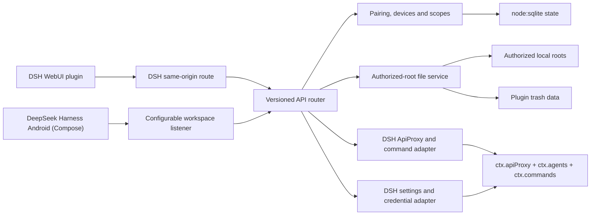

# 架构

## 组件

包同时声明 `dsh.bundle` 和 `dsh.client`。Profile patch 插入一个 Host row；DSH client module scanner 从同一包发现 `./client`，因此安装者只需执行一次 `dsh plugin add`。

Web Client 使用独立的外部语言 store 跨多个 DSH slot React 根同步界面语言，默认值为 `zh-CN`。语言按钮切换 `zh-CN`/`en` 并写入浏览器存储；slot 注册会随语言变化刷新标签。（2.2.0 删除了独立页，原先「独立工作区同时更新文档标题和 `lang` 属性」这条行为随之消失。）

桌面端的「手机设置」**内联渲染在 DSH 自带设置页里**：入口是 `settings.section` 插槽（`id: dsh-remote-bridge`、`order: 2`，紧跟 pocket-relay 的「📱 手机访问」之下）。

为什么不套弹窗：早先的版本在设置页里放一个「打开手机设置面板」按钮，真正的设置藏在按钮后面的模态框里。用户点进去只看到一句话，直接问「其他的可以设置的东西那去了」—— **入口看起来是空的，因为内容在下一层**。设置页本身就是容器，把弹窗嵌进设置页是设计错误。所以 `PhoneSettingsBody`（导航栏 + 内容区，无对话框外壳）被抽出来，由设置页内联渲染；原先的 `shell.overlay` 弹窗链路、`WorkspacePanel` 与 `dsh-remote-bridge:open-panel` 事件已随之一并删除 —— 没有任何东西会再打开那个弹窗。

原先侧边栏 `sidebar.footer.action` 的齿轮按钮已删除：入口分散在侧栏图标和设置页两处会让同一件事有两个起点，现在远程访问、配对与客户端下载都收在设置页一处。面板导航依次是 根目录 / 远程访问 / 设备 / 识图 / 回收站 / 审计 / App 下载 —— **不含文件树**：文件工作区已在 2.2.0 整体删除。「识图」是本轮新增的第 4 项（图片交接目录名 + 只读的出厂默认与兜底目录）。`App 下载` 刻意排在最后：它是给**新手机**准备的一次性目的地，不是日常管理页。

**独立页已于 2.2.0 删除。** 此前 `WorkspaceApp` 与 `AdminOverlay` 导出给 `/dsh-workspace`（移动 WebView、直链、故障排查），提供文件树与 CodeMirror 6 编辑器；现在 `src/standalone/`、`assets/workspace.html`、`src/client/editor.tsx` 以及 `workspace.tsx` 里的 `WorkspaceApp`/`DirectoryNode`/`CommandDialog`/`AdminOverlay` 全部移除，连同 8 个 `@codemirror/*` 与 `@lezer/highlight` 依赖。删除的理由是手机 App 的文件页已原生覆盖同一套能力，桌面上这个页面无人使用，却让发布包从 0.25 MB 涨到 1.72 MB。

**保留的是接口，不是页面**：`/dsh-workspace-api` 代理前缀与全部 REST 文件端点（`/roots`、`/roots/{rootId}/entries`、`/roots/{rootId}/content`、`/roots/resolve`、`/trash`）原样不动，手机 App 靠它们管理文件；设置面板的六个分区也一个未减。因此「桌面端没有文件管理界面」是产品取舍，不是接口退化。

`conversation.view` 插槽（会话内文件标签）不再注册。二维码来自 `src/client/app-qr.ts`（由 `scripts/generate-app-qr.mjs` 生成，勿手改）：以 data URL 内联 SVG，客户端零依赖、零网络请求，且指向 Releases **列表页**而非具体文件，所以发新版不必重新生成。

## 图片交接的两半

纯文本模型发图时，图片在**发消息前**被换成「工作区文件 + 路径文本」（写盘见
`handoffImagesForTextOnlyModel`），落点由「会话工作目录 + 识图路径」推出。显示这条链路分两截：

| 谁 | 怎么拿到图 |
| --- | --- |
| 手机 App | `GET /api/v1/image-handoff?sessionId=…&name=…`（设备令牌 + `files.read` + 会话归属） |
| DSH WebUI | `GET /plugin/dsh-remote-bridge/raw?sessionId=…&name=…`（回环 + 同源 + 文件名白名单 + 字节自证） |

两条路都**不接受目录参数**：宿主按会话工作目录自己推出目录，用的是与写盘同一个
`sessionWorkspaceDir()`。WebUI 那条为什么不能并进 REST 前缀：`` 带不了
`Authorization` 头，而 `/dsh-workspace-api` 上每个请求都要令牌或回环管理身份 ——
所以它是 `attachEmbeddedRoutes` 的第二个注册项，各有各的信任模型。

浏览器半边（`src/client/handoff.tsx`）由两截组成，缺一不可：Conversation Definition 把
「那条交接消息」变成 Chat store 里的一个节点；`conversation.chat.turnTail` 座位把它画出来。
座位选 Turn 尾而不是 Chat 节点，理由与 dsh-image-paths 一致：Chat 节点座位会把这个 kind 收进
**过程分组**，standard 模式一折叠，DOM 里有、肉眼没有；Turn 尾在独立成行的白名单内，
任何工作详情模式下都可见。解析只认**用户消息**里的行首标记（`🖼️ 图片 N` / `🖼️ Image N`），
助手正文、上下文注入、工具输出里引用的路径一律不渲染。

识图路径可在设置页修改（`settings.image_handoff_subdir`），交接写盘与两条读图路由都通过
getter 现读 —— 改完立即生效，不需要重启 dsh。
